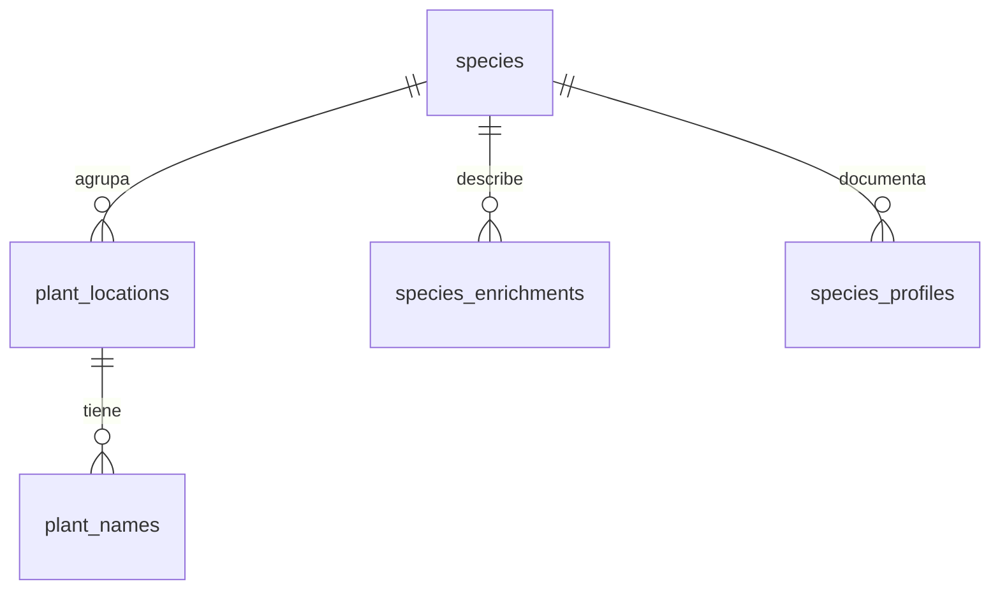

# Modelo de datos de plantas

## Alcance de la tarea

Guardar especie, nombre común por idioma, coordenadas e identificador de cada planta y cargar
el inventario para las pantallas. Conservar el enriquecimiento Wikipedia del prototipo y la
integración Pl@ntNet de `main`. Las fuentes futuras son contexto, no funcionalidades implementadas.

## Esquema actual: cinco tablas de catálogo

| Tabla | Datos y responsabilidad |
|---|---|
| `species` | ID interno, nombre científico base y fuente del catálogo. |
| `plant_locations` | ID del ejemplar, especie opcional, nombre científico original, coordenadas WGS84, distrito/barrio, fuente, ID externo, enlace y fecha de importación. |
| `plant_names` | Nombre común de un ejemplar y su idioma (`es`, `ca`, etc.). |
| `species_enrichments` | Descripción breve y extracto Wikipedia por especie/idioma, URL del artículo, Wikidata ID, fecha y foto opcional con créditos. |
| `species_profiles` | Ficha editorial curada por especie/idioma: descripción, familia, floración, curiosidad y fuentes (`jsonb`). Texto verificado por el equipo; la foto sigue viniendo de `species_enrichments`. |

`users` es la sexta tabla, conservada del scaffold. No se añaden tablas de observaciones que
todavía no utiliza ningún flujo. Pl@ntNet identifica fotografías; no persiste resultados.



Ejemplo: cuatro adelfas tienen cuatro filas en `plant_locations`, sus nombres es/ca en
`plant_names`, una especie compartida y un enriquecimiento Wikipedia compartido.
Los nombres se mantienen por ejemplar porque el inventario distingue `macho`/`hembra`.
La lista de nombres de una especie se obtiene con `DISTINCT`; no se guarda otra copia canónica.
Un nombre genérico de especie sin ejemplar asociado requeriría ampliar el modelo más adelante.

## Identidad, idioma y procedencia

- El ID interno es independiente de `idarbol`. `(source, external_id)` identifica una planta
  importada y evita duplicados al repetir la carga. La misma clave externa puede existir en otra fuente.
- `(source, scientific_name)` agrupa etiquetas simples dentro de una fuente. No es una identidad
  taxonómica global ni resuelve sinónimos entre proveedores. No se fusionan automáticamente especies
  de fuentes distintas. GBIF y la reconciliación de taxones quedan fuera de este incremento.
- El nombre científico original conserva cultivar/sexo. El nombre base se extrae de forma
  conservadora para buscar en Wikipedia. Una especie ambigua puede quedar `NULL` sin perder la planta.
- Un nombre por ejemplar e idioma. La lectura prueba idioma solicitado, idioma base, es, ca, en;
  devuelve el idioma real. Las traducciones de botones pertenecen al frontend.
- La fuente de los nombres se hereda del ejemplar. La fuente del texto/foto se conserva en el
  enriquecimiento. No hay un registro genérico ni JSON original por cada objeto externo.
- Las coordenadas tienen `CHECK` y el índice inicial permite filtros rectangulares; no es un
  índice espacial para búsquedas de distancia. Importar no equivale a verificar la existencia actual.

Los términos del inventario municipal se mantienen en `VALENCIA_SOURCE` en el adaptador;
`source`, `source_url` e `imported_at` permiten identificarlos sin copiarlos a todas las filas.
El enriquecimiento conserva licencia/enlace del texto y créditos propios de la foto como columnas
sencillas. Son metadatos para una atribución pequeña, no un sistema de gestión de licencias.
El enlace al artículo permite acceder a los autores/historial. El frontend debe conservar los
créditos al publicar contenido reutilizado. No se necesita mostrar JSON ni campos internos al usuario.

## Flujo de importación

Las rutas conectan URLs y controladores; estos validan parámetros. Los servicios integran las
fuentes y acceden a la base:

| Servicio | Responsabilidad |
|---|---|
| `valenciaOpenData.ts` | Descarga/valida GeoJSON y normaliza campos. |
| `inventoryImport.ts` | Guarda especies, plantas y nombres juntos. |
| `treeCatalog.ts` | Lista ligera y ficha con nombre elegido por idioma. |
| `speciesEnrichment.ts` | Consulta Wikipedia/Commons: texto, Wikidata y foto con créditos. |
| `wikipediaImport.ts` | Guarda enriquecimientos de especies pendientes. |
| `speciesCatalog.ts` | Lee nombres distintos y enriquecimiento por especie. |

| Campo municipal | Destino |
|---|---|
| `idarbol` | `plant_locations.external_id`, único dentro de `source`. |
| `nom_botanico` | Nombre original; el binomio reconocido va a `species.scientific_name`. |
| `nom_comu_c` / `nom_comu_v` | `plant_names` con idioma `es` / `ca`. |
| Coordenadas GeoJSON `[lon, lat]` | `longitude`, `latitude` WGS84. |

`Falta` en nombre botánico o estado general excluye la posición: no se guarda como planta.
Un nombre común `Falta` se descarta. Una planta real sin especie identificada sí se conserva.
Se piden 1–200 registros, `outSR=4326`, orden `objectid ASC` y `resultOffset`. Los cambios del
proveedor pueden mover offsets durante el recorrido; no es un snapshot completo del inventario.

Un batch transaccional y un bloqueo serializan imports concurrentes. Se usa CTE con parámetros
porque neon-http no admite callbacks interactivos de `db.transaction`. Un fallo al guardar nombres
revierte también plantas/especies de esa página. No hay sincronización ni histórico de importaciones:
repetir conserva campos existentes. Un fallo de descarga devuelve 502; uno de persistencia, 500.

Los contadores cumplen `fetched = stored + excluded + skipped + failed`; consulta los ejemplos de
ejecución y endpoints en el [README](../README.md).

## API y Wikipedia

- `GET /trees`: lista ligera con ID, especie, nombre elegido, coordenadas, fuente e ID externo.
  Incluye nombre científico original; no repite descripciones/licencias por árbol.
- `GET /trees/:id`: añade nombres disponibles, distrito/barrio, enlace/fecha de origen y `species`.
- `GET /species`: nombres distintos y enriquecimiento disponible, o campos `NULL` si falta.
- `GET /species/:id`: ficha completa de una especie: fila del catálogo (con perfil editorial y
  enriquecimiento resueltos por idioma, `content` ya resuelto con la precedencia editorial →
  Wikipedia) y `locations` con el total y los ejemplares reales de la especie, paginados por
  clave (`?afterLocationId=`, `?locationLimit=`). 400 si el id no es numérico, 404 si no existe.
- `POST /species/enrich`: sin `lang`, busca especies sin ningún enriquecimiento Wikipedia y usa
  es → en como fallback. Con `lang=es`/`lang=en`, busca registros pendientes por especie/fuente/idioma
  y consulta solo esa edición. Puede añadir inglés a una especie con español sin sobrescribirlo.
  Una edición inexistente cuenta como `notFound`; fallos de un artículo no borran la planta ni
  impiden guardar otros artículos. Repetir omite las completadas para el modo solicitado.

Los idiomas son filas distintas de `species_enrichments`, no columnas nuevas. La clave única
`(species_id, source, language)` evita duplicados. No requiere otra migración. La lectura con
`lang=en` elige la fila inglesa disponible y conserva el fallback de lectura si falta ese idioma.
El enriquecimiento descarga el artículo original; no es un servicio de traducción automática.

Se conservan los campos del prototipo `description`, `culturalExtract`, `wikipediaUrl`,
`wikipediaLang`, `wikidataId`, `imageUrl`, `source`, `fetchedAt`. `culturalExtract` es un alias del
extracto enciclopédico, no contenido cultural local verificado. `enrichment` reúne texto y su
atribución; `image` reúne foto y créditos. Son representaciones API, no copias en tablas distintas.

Una foto sin condiciones reutilizables reconocidas no se guarda ni publica como `imageUrl`;
se conserva el texto aunque falle la consulta de imagen. No se guarda una cola de fotos pendientes.
Las imágenes se referencian por URL: no se descargan binarios a PostgreSQL.

## Contenido editorial y seed

`species_profiles` guarda el texto de la ficha verificado por el equipo (UT 918), separado del
enriquecimiento automático: mismo `species_id`, ciclo de vida y procedencia distintos. La
extracción combina ambas tablas con dos `lateral` por preferencia de idioma y deja el texto
principal como `coalesce(profile.description, enrichment.extract, enrichment.description)`:
lo curado manda; Wikipedia respalda y aporta la foto con créditos. Un CHECK exige que cada
fila tenga descripción o curiosidad; las fuentes van en `sources` (`jsonb`, lista de
`{name, description, url}`) para poder auditar cada texto (RNF6).

La seed (`npm run db:seed`, `src/db/seedProfiles.ts`) carga las fichas de la demo en `es` y es
**idempotente**: puede ejecutarse cualquier número de veces sin duplicar nada. Para cada especie:
busca la fila `species` por nombre científico (cualquier fuente; el import municipal ya trae
algunas) y le adjunta el perfil; solo crea una `species` con `source='NATUREMAPS'` si no existe.
El perfil se inserta con upsert sobre su clave natural `(species_id, language)`: la primera vez
inserta y las siguientes actualizan el texto, así que corregir un contenido es editar la seed y
volver a ejecutarla, y añadir `va`/`en` no tocará lo existente. La seed nunca escribe en
`plant_locations`, `plant_names` ni `species_enrichments`; los tests la ejecutan dos veces para
garantizar la propiedad.

## Comandos y comprobación

La migración inicial es `drizzle/0000_plant_catalog.sql`, acompañada de snapshot y journal.
El reinicio experimental ya se completó; los cambios siguientes requieren nuevas migraciones,
sin borrar datos ni editar la inicial aplicada. Para instalar desde cero, usa una base vacía.

En PowerShell:

```powershell
npm.cmd run build
npm.cmd run test:catalog
```

El build comprueba TypeScript. Los tests ejecutan SQL y HTTP sobre PGlite y servicios ficticios:
verifican creación inicial, importación atómica/idempotente,
idiomas, `Falta`, textos, imágenes y rutas existentes. No usan `.env` ni conectan a Neon.

`db:generate` genera SQL y snapshot locales a partir del esquema; no modifica Neon.
`db:migrate` sí aplica SQL a la conexión configurada. Detener el servidor antes de migrar.

```sql
SELECT table_name FROM information_schema.tables
WHERE table_schema = 'public' AND table_type = 'BASE TABLE'
ORDER BY table_name;
```

Después de la migración inicial deben aparecer `plant_locations`, `plant_names`, `species`,
`species_enrichments`, `species_profiles` (migración `0001`), `users`. El historial está en otro esquema.

## Fuera de alcance ahora

Persistencia de observaciones Pl@ntNet/usuarios, sincronización de cambios municipales,
deduplicación entre fuentes, GBIF, BDBCV, parques, rutas y traducciones automáticas. Cada uno
requerirá su propio cambio cuando se implemente el flujo que lo utiliza.
